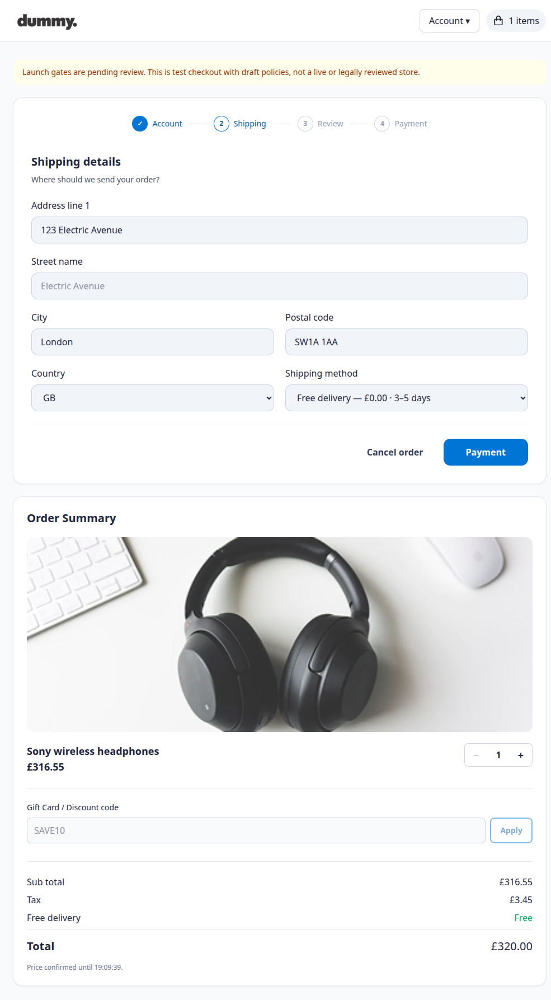
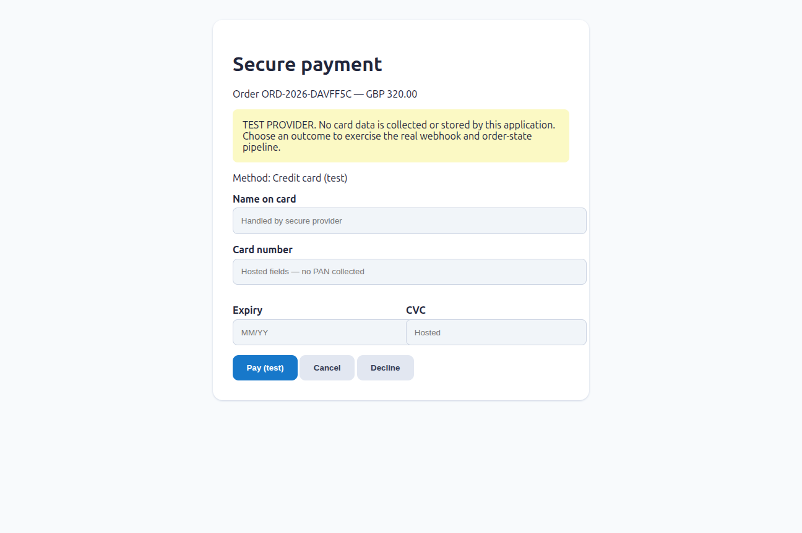

# Checkout

Server-authoritative checkout: **React + TypeScript** UI, **Express** API, **PostgreSQL** storage. The original demo UI is preserved; pricing, quotes, tax, inventory, orders, payments, identity, and receipts are server-owned.

> [!WARNING]
> Local/test mode only: `PAYMENT_PROVIDER=test`, `liveCheckoutEnabled: false`, draft policies. No live/sandbox provider adapter and no legal/PCI certification.

## Screenshots

| Shipping | Review |
| --- | --- |
| [](docs/screenshots/01-shipping.png) | [](docs/screenshots/02-review.png) |

| Hosted test payment | Paid confirmation |
| --- | --- |
| [](docs/screenshots/03-test-payment.png) | [](docs/screenshots/04-confirmation.png) |

## Layout

```text
checkout-page/  React UI, typed API clients, form/a11y tests
server/         Express API, PostgreSQL modules, security, webhooks, reconciliation
shared/         Zod contracts and DTOs
docs/           Integration, API, database, security, launch, and deployment guides
```

## Quick start

Requirements: Node 22+, npm, Docker, ports `5173`, `3001`, `55432` free.

```bash
docker run --name checkout-pg \
  -e POSTGRES_USER=checkout \
  -e POSTGRES_PASSWORD=checkout \
  -e POSTGRES_DB=checkout_test \
  -p 55432:5432 \
  -d postgres:16

cp .env.example .env
npm install
npm run db:migrate
npm run db:seed
npm run dev
```

Open <http://localhost:5173/>. Vite proxies `/api` to the API on port `3001`.

Stop with `Ctrl+C`, then:

```bash
docker stop checkout-pg
docker rm checkout-pg
```

## Use the checkout

1. Continue as guest or register/sign in. Guest carts merge on sign-in.
2. Fill shipping; country changes reload supported shipping methods.
3. Review server-calculated totals and accept necessary consent. Try `SAVE10`.
4. Choose card or PayPal. Card fields are hosted placeholders; no PAN is accepted.
5. On the hosted test page choose **Pay (test)**, **Decline**, or **Cancel**.
6. Confirmation appears only after server verification. Pending orders are polled.
7. Refunds and reconciliation can be exercised through the API/CLI.

## Commands

| Command | Purpose |
| --- | --- |
| `npm run typecheck` | Type-check all workspaces |
| `npm run lint` | Lint all workspaces |
| `npm run test` | 18 server integration tests + 8 React/a11y tests |
| `npm run build` | Build shared, server, and web |
| `npm run docs:check` | Verify required docs |
| `npm run reconcile` | Reconcile stale test payments and stock |
| `npm run dev` | Run API and Vite locally |

Integration tests reset the local test database. Never run them against shared data.

## Best practices

### Money and pricing

- Price on the server only.
- Store money as integer minor units.
- Use short-lived, versioned quotes bound to cart, address, and shipping method.
- Revalidate quotes inside a transaction before order creation.
- Keep tax, currency, jurisdiction, and promotion rules configurable.

### Security

- Hash passwords server-side with scrypt.
- Use HttpOnly `SameSite=Lax` session cookies; `Secure` in production.
- Enforce CSRF double-submit tokens and origin checks.
- Return generic login errors and throttle failures.
- Scope idempotency keys to customer and operation.
- Return `404` for other customers' resources.
- Keep raw card data out of React, the server, logs, URLs, and the database.
- Verify webhook signatures, timestamp tolerance, event IDs, and status ordering.
- Redact logs; never log request bodies, passwords, tokens, or PANs.

### Operations

- Inject secrets from the environment; commit only `.env.example`.
- Fail startup on missing or inconsistent configuration.
- Use transactions, unique constraints, and stock reservations.
- Run `npm run reconcile` for stale sessions and expired reservations.
- Keep providers behind interfaces; add an adapter only after provider selection.
- Treat legal/tax/privacy gates as release blockers, not UI copy.

### Before live checkout

- Register a reviewed payment provider adapter.
- Replace placeholder merchant and policy details.
- Use HTTPS, same-origin deployment, `COOKIE_SECURE=true`, and managed PostgreSQL.
- Complete every gate in [LAUNCH_CHECKLIST.md](docs/LAUNCH_CHECKLIST.md).
- Do not describe the app as legally compliant or certified.

## Deployment

- [Push to GitHub](docs/GITHUB.md)
- [Deploy to Vercel](docs/VERCEL.md)
- [Architecture and boundaries](docs/INTEGRATION_MAP.md)
- [API contract](docs/OPENAPI.md)
- [Database schema](docs/DATABASE.md)
- [Request flows](docs/REQUEST_FLOW.md)
- [Compliance gates](docs/COMPLIANCE.md)
- [PCI scope](docs/PCI_SCOPE.md)
