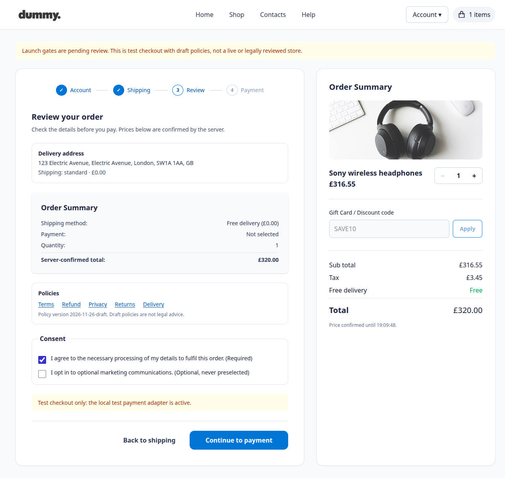
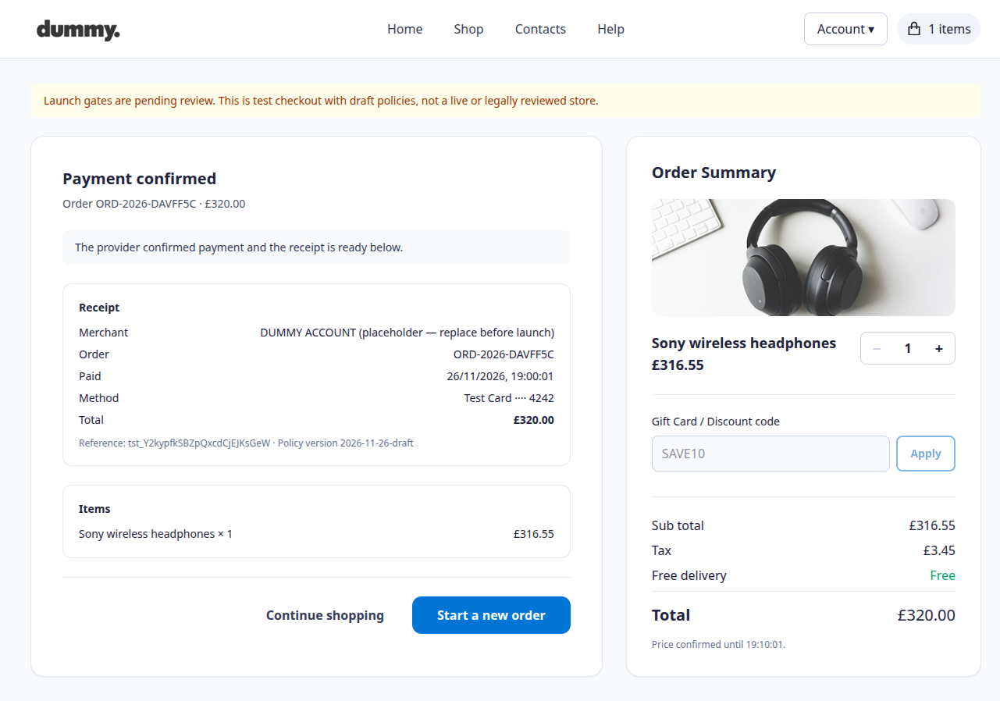

# Checkout

A server-authoritative checkout built with **React + TypeScript**, **Express**, and **PostgreSQL**. The original browser-only demo UI is preserved, but prices, quotes, tax, inventory, orders, payment state, identity, and receipts are all owned by the server.

> [!WARNING]
> This repository is configured for **local test checkout only**. It uses `PAYMENT_PROVIDER=test`, `liveCheckoutEnabled: false`, and draft policies. No live or sandbox payment adapter is registered, and this project makes no legal or PCI compliance certification claims.

## Screenshots

All screenshots below are from the local test provider. Card fields are disabled placeholders; no raw card data is collected or stored.

| Shipping | Review |
| --- | --- |
| [](docs/screenshots/01-shipping.png) | [](docs/screenshots/02-review.png) |

| Hosted test payment | Paid confirmation |
| --- | --- |
| [](docs/screenshots/03-test-payment.png) | [](docs/screenshots/04-confirmation.png) |

## What is included

- Guest and registered checkout with server-side sessions, scrypt password hashing, HttpOnly SameSite cookies, CSRF protection, generic login errors, throttling, recovery, and guest-cart merge.
- Integer minor-unit pricing with short-lived, versioned quotes; configurable tax, currency, jurisdiction, shipping, promotion, and legal policies.
- Stock reservations, idempotent order/payment/refund operations, transactions, and unique constraints.
- Provider-neutral payment interface with a local signed-webhook test adapter, replay/dedupe handling, monotonic status transitions, refunds, and a reconciliation CLI.
- Compliance gates, draft policy pages, privacy request/export/anonymize endpoints, redacted structured logs, and counters.

## Requirements

- Node.js 22+
- npm
- Docker for PostgreSQL
- Free local ports: `5173` (web), `3001` (API), `55432` (PostgreSQL)

## Quick start

```bash
docker run --name checkout-pg \
  -e POSTGRES_USER=checkout \
  -e POSTGRES_PASSWORD=checkout \
  -e POSTGRES_DB=checkout_test \
  -p 55432:5432 \
  -d postgres:16

cp .env.example .env
npm install
npm run db:migrate
npm run db:seed
npm run dev
```

Open <http://localhost:5173/>. The Vite dev server proxies `/api` to the API on port `3001`.

To stop:

```bash
# Press Ctrl+C in the terminal running npm run dev
docker stop checkout-pg
docker rm checkout-pg
```

## Using the checkout

1. **Start a session.** Choose **Continue as guest**, or register/sign in. Registering or signing in after a guest cart exists merges the guest cart into the account.
2. **Enter shipping details.** Country selection reloads destination-specific shipping rates. The featured item is `SONY-WH-1000`; try promo code `SAVE10`.
3. **Review the order.** Prices are recalculated by the server. Necessary consent starts unchecked; optional marketing is never preselected. Draft policy links are available in the review panel.
4. **Choose a payment method.** Select **Credit card** or **PayPal**. The displayed card fields are hosted-provider placeholders; this application never accepts a PAN, expiry, or CVC.
5. **Use the hosted test page.** Choose **Pay (test)**, **Decline**, or **Cancel**. Each outcome goes through the same signed event pipeline as a real webhook.
6. **Wait for server confirmation.** Success is shown only after the server reports a paid order. Pending payments are polled; the URL alone never implies success.
7. **Exercise support flows.** Paid orders can be refunded through the documented API, then viewed again to see the refunded receipt state. Run `npm run reconcile` to process stale provider sessions and expired reservations.

## Useful commands

| Command | Purpose |
| --- | --- |
| `npm run dev` | Start API and Vite dev server |
| `npm run typecheck` | Type-check all workspaces |
| `npm run lint` | Lint all workspaces |
| `npm run test` | Run 18 server integration tests and 8 React/a11y tests |
| `npm run build` | Build shared, server, and web bundles |
| `npm run docs:check` | Verify required documentation exists |
| `npm run reconcile` | Reconcile stale test-provider payments and stock |

The integration tests reset the local test database between cases. Never point them at a shared or production database.

## Configuration

Copy `.env.example` to `.env` for local development. All example values are non-secret test values. Required configuration is validated at startup; the app exits clearly if something required is missing or inconsistent.

For a deployed environment:

- Inject real secrets from the deployment platform; never commit them.
- Set `COOKIE_SECURE=true` and serve over HTTPS behind a same-origin proxy.
- Replace placeholder merchant/legal details.
- Register a real provider adapter. The repository intentionally ships only the test adapter.
- Complete and review every launch gate before enabling live checkout.

## Publishing to GitHub

For a step-by-step guide to push this project to <https://github.com/Ruto1M/dummy-account>, including secret checks, conflict recovery, and deployment notes, see [docs/GITHUB.md](docs/GITHUB.md).

## Architecture at a glance

```text
checkout-page/   React UI, typed API clients, form/a11y tests
server/          Express API, PostgreSQL modules, security, webhooks, reconciliation
shared/          Zod contracts and DTOs shared by browser and server
docs/            Integration, API, database, request-flow, compliance, and launch docs
scripts/         Documentation check
```

Detailed references:

- [Integration map](docs/INTEGRATION_MAP.md)
- [API contract](docs/OPENAPI.md)
- [Database schema and migrations](docs/DATABASE.md)
- [Request flows](docs/REQUEST_FLOW.md)
- [Compliance gates](docs/COMPLIANCE.md)
- [PCI scope](docs/PCI_SCOPE.md)
- [Launch checklist](docs/LAUNCH_CHECKLIST.md)

## Safety notes

Do not add raw PAN, expiry, CVC, provider secrets, webhook secrets, passwords, or card data to code, forms, URLs, logs, or the database. The test provider uses disabled fields and a fixed test last-four value only for receipt display.
